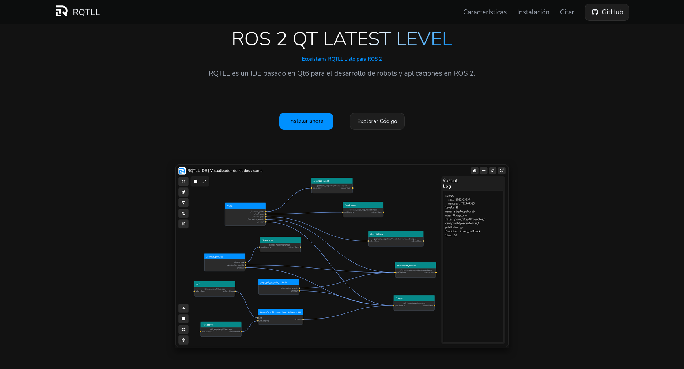

# RQTLL

ROS 2 QT LATEST LEVEL

<a href="https://rqtll.github.io/" target="_blank">
  <picture>
    <source media="(prefers-color-scheme: light)" srcset="https://raw.githubusercontent.com/RQTLL/.github/refs/heads/main/src/light.png">
    <source media="(prefers-color-scheme: dark)" srcset="https://raw.githubusercontent.com/RQTLL/.github/refs/heads/main/src/dark.png">
    
  </picture>
</a>
